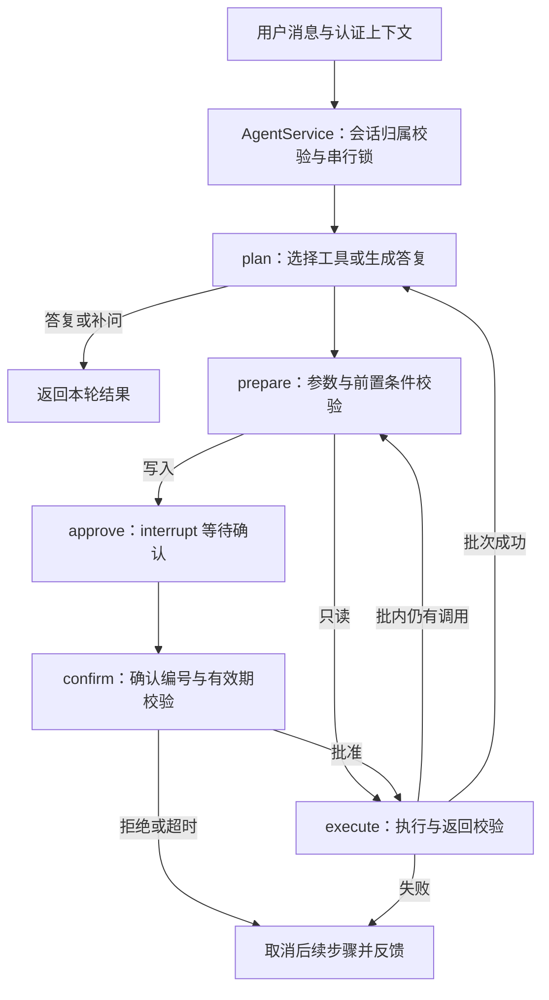

# Agent 架构

## 工作流

`DemoPlanner` 和 `HTTPModelClient` 使用同一工作流及执行器。前者提供有限规则的离线演示，后者将系统提示词、历史和当前可用工具交给模型。

## 会话与工具协议

`AgentService` 提供 `chat`、`confirm`、`inspect` 和 `history`。调用方提供可信用户身份，模型不能指定 `user_id` 或 `operation_id`。

工具参数、返回信封和公开响应以 `contracts.py` 中的 Pydantic 类型为准。业务函数通过 `ToolRegistry.bind` 绑定，替换函数不会改变工具的写入分类。业务层负责记录归属、数据库冲突和持久化幂等。

同一模型响应中的多个工具调用顺序执行，逐个追加匹配的 `tool_call_id` 结果。批次结束后再请求模型。前序失败或取消时，为未执行调用补齐 `SKIPPED` 结果后停止本轮。

事务工具按前置查询逐步开放：本轮先检索知识，再查询办理要求，随后才能生成草稿；执行前再次校验前置条件。

## 确认与恢复

写入参数、操作号和确认号在 `prepare` 中生成并保存，`approve` 通过 LangGraph `interrupt` 暂停。确认入口校验会话归属、确认号和有效期，通过 `Command(resume=...)` 恢复；参数变更需取消后重新发起。

默认确认有效期为 300 秒。每个写调用分别确认，会话锁拦截同进程重复或并发提交。写操作异常时可能结果未知，返回操作号供业务方核实，不自动重试或回滚已完成的操作。

## 运行约束

- 读工具和模型瞬时故障最多尝试 2 次；写工具仅尝试 1 次。
- 每轮最多 10 次规划和 32 次工具调用。
- 模型 HTTP 连接超时为 10 秒，请求超时为 45 秒；同步业务函数需自行实现超时。
- Mock 数据及结果标记为 `simulated=true`，知识来源由检索结果提供。

会话 checkpoint、归属、锁及 Mock 记录均为内存状态，仅支持单进程运行。应用生命周期内复用一个 `AgentService`。多进程或重启恢复需要同时设计持久化 checkpoint、会话归属、分布式锁和业务幂等；当前不支持长会话压缩及自动清理。
