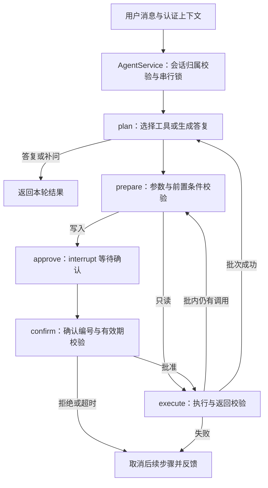

# Agent 架构

## 工作流

`DemoPlanner` 和 `HTTPModelClient` 使用同一工作流及执行器。前者提供有限规则的离线演示，后者将系统提示词、历史和当前可用工具交给模型。

## 会话与工具协议

`AgentService` 提供 `chat`、`confirm`、`inspect` 和 `history`。调用方提供可信用户身份，模型不能指定 `user_id` 或 `operation_id`。

工具参数、返回信封和公开响应以 `contracts.py` 中的 Pydantic 类型为准。业务函数通过 `ToolRegistry.bind` 绑定，替换函数不会改变工具的写入分类。业务层负责记录归属、数据库冲突和持久化幂等。

同一模型响应中的多个工具调用顺序执行，逐个追加匹配的 `tool_call_id` 结果。批次结束后再请求模型。前序失败或取消时，为未执行调用补齐 `SKIPPED` 结果后停止本轮。

事务工具按前置查询逐步开放：本轮先检索知识，再查询办理要求，随后才能生成草稿；执行前再次校验前置条件。

## 时间空间工具契约

C 的三个查询工具均为只读，参数模型定义于 `backend/agent/contracts.py`，名称登记于 `tool_registry.py`。只有绑定实现后，工具才会出现在模型可用列表中；原有 13 个 Mock 保持独立可用。

| 工具名 | 参数模型 | 必填参数 | 成功结果的 `data` |
| --- | --- | --- | --- |
| `get_course_schedule` | `CourseScheduleArgs` | `student_id: str` | `weekday`、`course_list`（每项含 `time/course_name/location`） |
| `analyze_free_time` | `FreeTimeArgs` | `student_id: str` | `free_periods`（每项含 `weekday/time_range`） |
| `get_empty_classroom` | `EmptyClassroomArgs` | `weekday: int`、`start_time: str`、`end_time: str` | `classroom_list`（每项含 `building/room`） |

学号须为非空字符串，不做数字转换；学号是查询参数，不能替代可信 `Context.user_id`，业务层负责校验查询权限。星期约定为 1=周一至 7=周日，时间为校园当地 `HH:MM`，结束须晚于开始且不跨天。接口未提供具体日期或教学周，不应据此保证指定日期的可用性，也不应将空教室转换成座位预约。

绑定沿用 `registry.bind(name, handler, simulated=True)`。`handler(args, context)` 接收上述 Pydantic 参数对象及可信上下文，并返回 `ToolResult` 或符合该信封的字典。例如 `ok({"weekday": 1, "course_list": []}, "模拟课表")`；业务返回示例中的字段应放在 `data` 内，不能直接将 `course_list` 等裸字典作为工具结果返回。绑定应在创建服务并处理请求之前完成；实际实现由 C 提供，不向模型暴露未绑定的工具。

## 确认与恢复

写入参数、操作号和确认号在 `prepare` 中生成并保存，`approve` 通过 LangGraph `interrupt` 暂停。确认入口校验会话归属、确认号和有效期，通过 `Command(resume=...)` 恢复；参数变更需取消后重新发起。

默认确认有效期为 300 秒。每个写调用分别确认，会话锁拦截同进程重复或并发提交。写操作异常时可能结果未知，返回操作号供业务方核实，不自动重试或回滚已完成的操作。

## 运行约束

- 读工具和模型瞬时故障最多尝试 2 次；写工具仅尝试 1 次。
- 每轮最多 10 次规划和 32 次工具调用。
- 模型 HTTP 连接超时为 10 秒，请求超时为 45 秒；同步业务函数需自行实现超时。
- Mock 数据及结果标记为 `simulated=true`，知识来源由检索结果提供。

会话 checkpoint、归属、锁及 Mock 记录均为内存状态，仅支持单进程运行。应用生命周期内复用一个 `AgentService`。多进程或重启恢复需要同时设计持久化 checkpoint、会话归属、分布式锁和业务幂等；当前不支持长会话压缩及自动清理。
