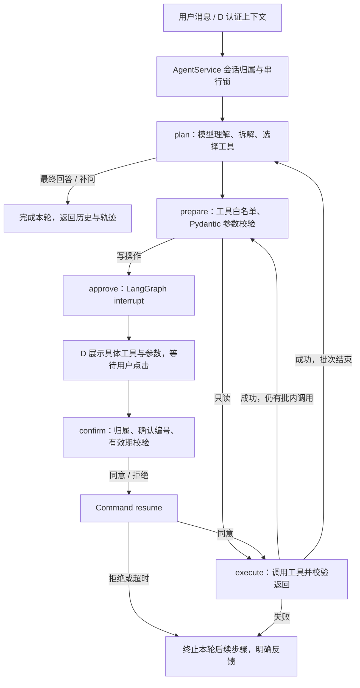

# A 模块架构

## 工作流

本包有两个可替换的规划器：`DemoPlanner` 使用有限中文规则，供离线验收；`HTTPModelClient` 将系统提示词、完整历史、工具 Schema 发给你配置的真实模型。二者使用同一张 LangGraph、同一执行器、同一确认逻辑，避免只演示一个绕过 Agent 的业务脚本。

## 状态与恢复

`AgentState` 保存 `messages`、当前轮起点、可信 `user_id`/时间、模型产生的当前批调用、批内指针、规范化参数、待确认摘要、确认结果、轮数、工具数和轨迹。

每个工具执行完成后追加 `tool_call_id` 对应结果，再继续下一调用；本批结束后才重新请求模型。一个模型响应里出现多个调用时也逐个执行，所有写调用分别暂停确认。用户取消或工具失败时，为未执行的批内调用追加 `SKIPPED`，保证下一轮历史中的工具消息配对完整。

确认参数、操作号、确认号在 `prepare` 中生成并保存，然后进入只调用 `interrupt` 的 `approve`。恢复会重入 `approve`，但不会重新生成参数或执行写操作。用户审批的是已经保存的参数；如需修改，取消后发起新的请求。

## 执行约束

- 参数经 Pydantic 校验，额外字段、无时区时间、倒置时段、未知工具均拒绝。
- `user_id` 和 `operation_id` 从后端上下文注入，不向模型开放。
- 6 个写工具由注册表静态分类；换 handler 不会取消确认要求，执行器再次检查是否批准。
- 确认默认 300 秒有效。确认号与当前待执行动作绑定，不匹配不恢复；超时恢复为拒绝。
- 每个会话用锁串行处理，同进程的重复/并发确认只会产生一次调用。
- 读工具默认最多 2 次尝试，只对明确瞬时故障重试。写工具只尝试 1 次。
- 写工具超时或异常时结果可能未知，返回操作号，终止本轮，不自动重试或继续让模型重规划写入。
- 最多 10 次规划、32 次工具调用；达到限制明确失败。Graph 递归限制 300 作为额外边界。
- 工具返回失败由代码直接生成失败答复；如果前面已经完成写入，会列出已有记录，避免误以为整轮回滚。

## 当前存储边界

会话 checkpoint 使用 `MemorySaver`，会话归属和锁也存在内存；Mock 业务记录使用 `MockCampus` 内存字典。重启后历史、确认和记录均丢失。本包是 A 的单进程独立开发版本，不具有跨进程或跨重启的 exactly-once 保证。

与 D 集成时，单个应用进程中复用同一个 `AgentService`。不要每次 HTTP 请求新建服务，也不要直接多 worker 部署此内存版本。后续持久化需同时迁移 checkpoint、会话归属和锁；业务方必须在数据库事务中实现幂等与冲突检查。只换 LangGraph 的 checkpointer 不能解决另外两部分。

业务函数是同步调用，执行器不强制杀死超时线程。B/C 的网络请求必须自行设置超时，数据库操作也应有合理的超时。模型 HTTP 请求已设置连接 10 秒、请求 45 秒的超时。

本版保留完整历史，尚未实现长会话压缩和过期会话清理。短期演示可通过 `/new` 开新会话；长期部署再和 D 设计持久化与保留期限。

## 事实与引用

所有 Mock 输出 `simulated=true`，响应会标注含模拟数据。知识工具的 `sources` 带 `source_id/title/content`；离线答复实际展示引用，真实模型由系统提示词约束引用，仍需在线语义验收。HTTP 层格式测试不证明模型在所有自然语言输入下都会正确规划、选择参数或引用资料。

参考：[LangGraph Interrupts](https://docs.langchain.com/oss/python/langgraph/interrupts)、[OpenAI Function calling](https://developers.openai.com/api/docs/guides/function-calling)。
